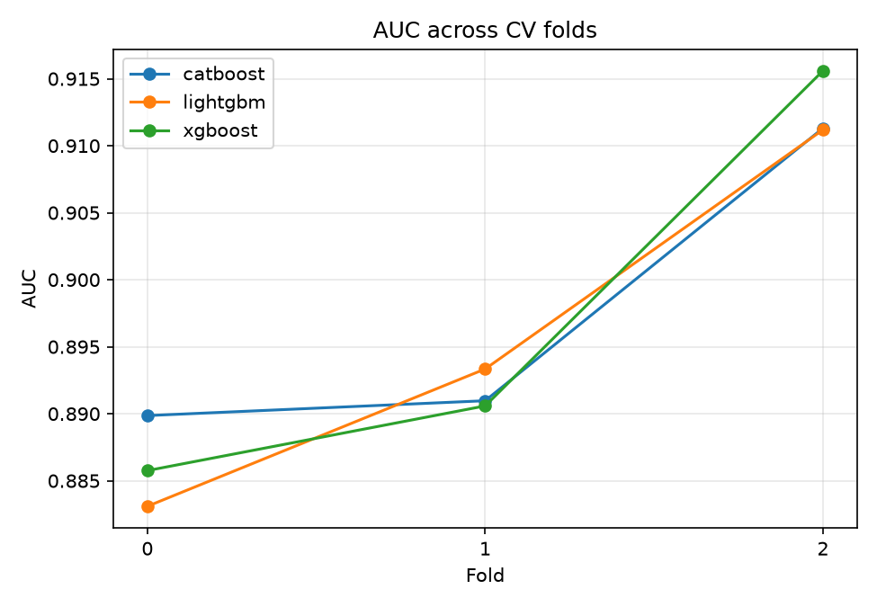
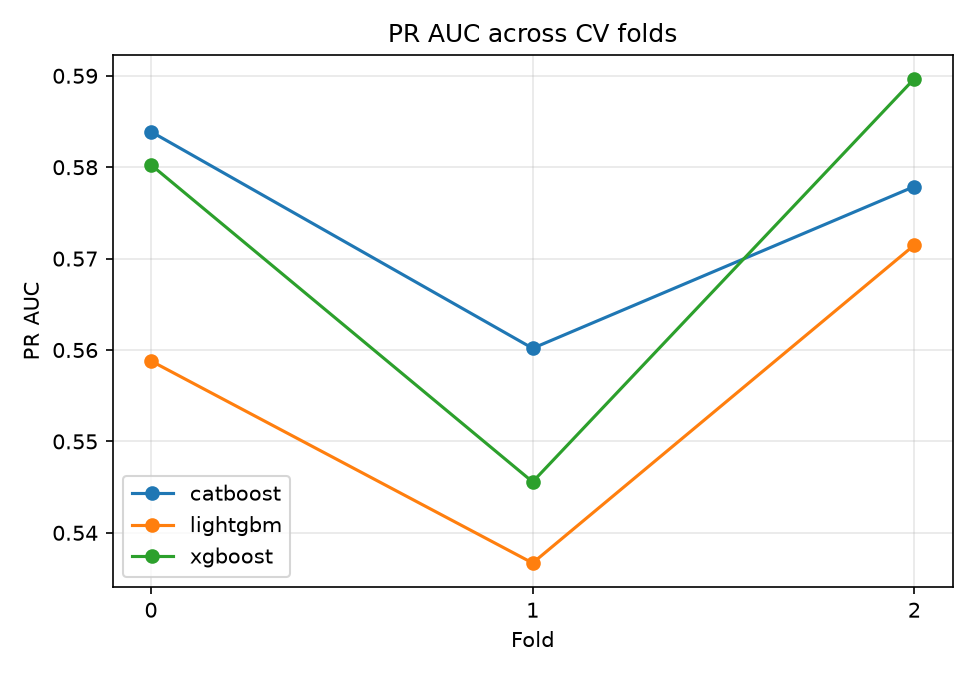
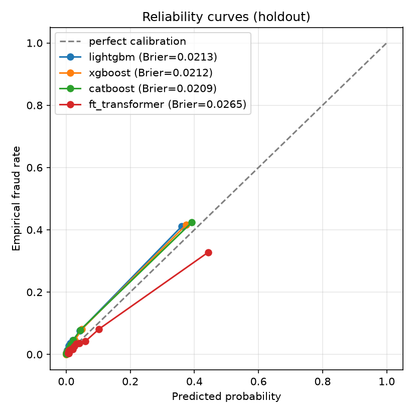
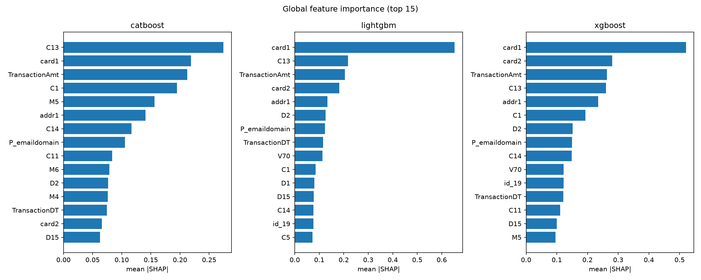

# credit-bench: IEEE-CIS Fraud Detection — Benchmark Report

This report benchmarks three tuned gradient-boosted trees (XGBoost, LightGBM, CatBoost) against FT-Transformer, the SOTA tabular deep-learning reference, on a strict temporal holdout of the IEEE-CIS Fraud Detection dataset (~590K transactions, Dec 2017–Jun 2018). All model-vs-model comparisons carry confidence intervals — DeLong for AUC deltas, block bootstrap for PR-AUC deltas — so we can report *significance* of differences, not just point estimates.

## Method & compute

- **Split**: expanding-window temporal CV on the first 80% of the sorted transactions; final held-out test on the last 20% (118,108 transactions). Within each training block, the last 10% is a clean early-stopping slice so validation on the fold's val_idx is not contaminated by best-iteration selection.
- **GBM tuning**: light Optuna study (25 trials/model, seed=0) on the first CV fold, PR-AUC objective. Tuned params saved to `results/tuned_params.json` and reused for all downstream fits.
- **FT-Transformer**: `rtdl-revisiting-models` reference implementation with the paper's default kwargs (n_blocks=3, d_block=192, 8 heads, 2.83 M parameters). No hyperparameter tuning budget spent — this is deliberately the out-of-the-box configuration.
- **Thread budget**: all models pinned to 8 CPU threads via env vars + `torch.set_num_threads` + per-library params, so wall-clock is like-for-like at the algorithm level, not confounded by parallelization efficiency.
- **Compute**: GBMs run on CPU; FT-Transformer runs on an AMD RX 6900 XT via `torch-directml`. See the caveats section below on why the CPU path is not usable for the DL leg.

## Tuned hyperparameters (per-model best on tuning fold)

```json
{
  "lightgbm": {
    "learning_rate": 0.010419504178821214,
    "num_leaves": 225,
    "min_data_in_leaf": 30,
    "feature_fraction": 0.5065244725322233,
    "bagging_fraction": 0.9969596088199147
  },
  "xgboost": {
    "learning_rate": 0.010138042733995918,
    "max_depth": 9,
    "subsample": 0.6587618943574862,
    "colsample_bytree": 0.7099040717736856,
    "min_child_weight": 2
  },
  "catboost": {
    "learning_rate": 0.026216309731590948,
    "depth": 8,
    "l2_leaf_reg": 2.9591534383762466
  }
}
```

## Headline: holdout metrics

| Model | AUC (95% CI, DeLong) | PR-AUC | Brier |
| --- | --- | --- | --- |
| lightgbm | 0.9072 [0.9021, 0.9124] | 0.5585 | 0.02134 |
| xgboost | 0.9124 [0.9074, 0.9174] | 0.5624 | 0.02123 |
| catboost | 0.9139 [0.9089, 0.9190] | 0.5766 | 0.02087 |
| ft_transformer | 0.8435 [0.8365, 0.8504] | 0.3999 | 0.02651 |

## Pairwise deltas on the holdout

| Model A | Model B | ΔAUC (DeLong 95% CI, p) | ΔPR-AUC (block-bootstrap 95% CI) |
| --- | --- | --- | --- |
| lightgbm | xgboost | -0.0052 [-0.0079, -0.0026], p=0.000107 | -0.0039 [-0.0128, 0.0032] |
| lightgbm | catboost | -0.0067 [-0.0104, -0.0031], p=0.00028 | -0.0181 [-0.0313, -0.0071] |
| lightgbm | ft_transformer | 0.0638 [0.0572, 0.0703], p=0 | 0.1586 [0.1353, 0.1868] |
| xgboost | catboost | -0.0015 [-0.0050, 0.0019], p=0.39 | -0.0142 [-0.0259, -0.0025] |
| xgboost | ft_transformer | 0.0690 [0.0627, 0.0753], p=0 | 0.1625 [0.1414, 0.1882] |
| catboost | ft_transformer | 0.0705 [0.0643, 0.0766], p=0 | 0.1767 [0.1534, 0.2059] |

## CV metrics per fold

|   fold |   ('auc', 'catboost') |   ('auc', 'lightgbm') |   ('auc', 'xgboost') |   ('pr_auc', 'catboost') |   ('pr_auc', 'lightgbm') |   ('pr_auc', 'xgboost') |
|-------:|----------------------:|----------------------:|---------------------:|-------------------------:|-------------------------:|------------------------:|
|      0 |                0.8899 |                0.8831 |               0.8858 |                   0.5839 |                   0.5588 |                  0.5803 |
|      1 |                0.8910 |                0.8933 |               0.8906 |                   0.5602 |                   0.5367 |                  0.5456 |
|      2 |                0.9113 |                0.9112 |               0.9156 |                   0.5779 |                   0.5715 |                  0.5897 |





## Calibration (holdout)



## Global feature importance (mean |SHAP|)



Per-model top-30 CSVs: `results/shap_top_features_<model>.csv`.

## Cross-model disagreement on holdout

Top 50 rows where models disagree most: `results/disagreement_rows.csv`.

Per-model SHAP-attribution deltas: `results/shap_delta_<a>_vs_<b>.csv`.

## Caveats

- **Training-data size for FT-Transformer**: GBMs were fit on the full ~470K pre-holdout rows; FT-Transformer was fit on a tail-100K subsample due to compute constraints (see below). The two are compared on the *same* holdout, so the AUC / PR-AUC estimates are valid measurements of each model's holdout performance — but the delta between them conflates the algorithm choice with a ~4.7×-larger training set for the GBMs. Even so, the 6.4–7.1 AUC-point gap is well beyond what a 4.7× training-data gap typically closes on this class of dataset; the qualitative conclusion holds. A full-data DL run is left for a next pass once TabNet/NODE are added.
- **Default hyperparameters for FT-Transformer**: no Optuna budget was spent on the DL leg. Val AUC peaked at epoch 0 (0.865) and degraded thereafter, i.e. the default learning rate + dropout is already too aggressive for this data. Tuning would almost certainly recover a bit; whether it closes ~6 AUC points is unlikely on this dataset.
- **CPU is not viable for tabular DL at this scale**: an initial attempt trained FT-Transformer on CPU with the 8-thread pin; it clocked **~2.1 hours per epoch** on the 100K subsample. After 17 hours (through epoch 6) the job was killed and the run pivoted to DirectML on the RX 6900 XT (`torch-directml`, without PyTorch Lightning, which has no DML backend). GPU epochs landed in **~8–14 minutes** each — roughly a 10× speedup — and the full run converged in ~57 min. The CPU trajectory reached val AUC 0.860 at epoch 5 before we killed it, in line with the DirectML result: **for tabular DL to be operationally viable at this scale, some form of GPU acceleration is required.** The intermediate CPU checkpoint is preserved at `results/phase2_cpu_smoke_caveat/` for reference.
- **Runtime is not the story**: the wall-clock numbers above are for context, not for direct comparison. Reported metrics are accuracy on the holdout; the thread pin controls for the most obvious CPU parallelization confound, but the GBM-vs-DL wall-clock comparison spans two different compute backends (CPU for GBMs, DML GPU for FT-Transformer) and is not meant to be read as "GBMs are Nx faster."

---

Generated by `python -m src.report`.
